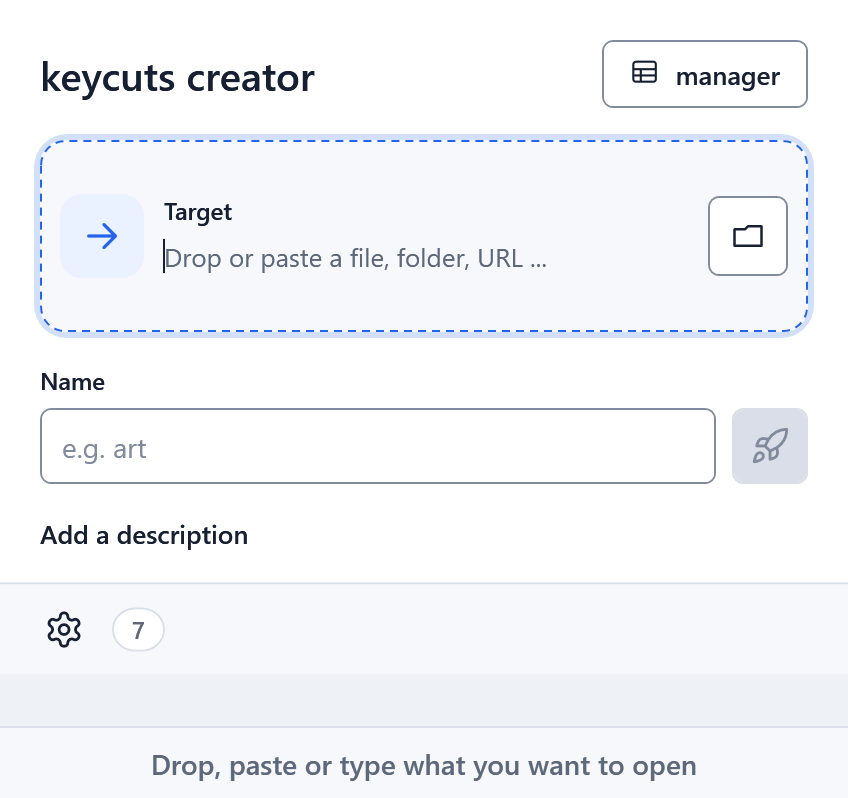
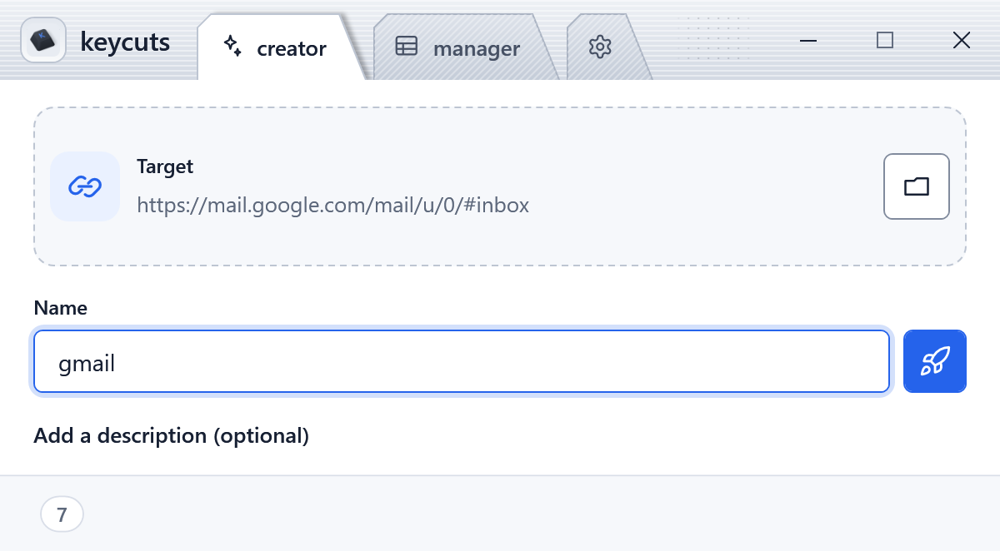
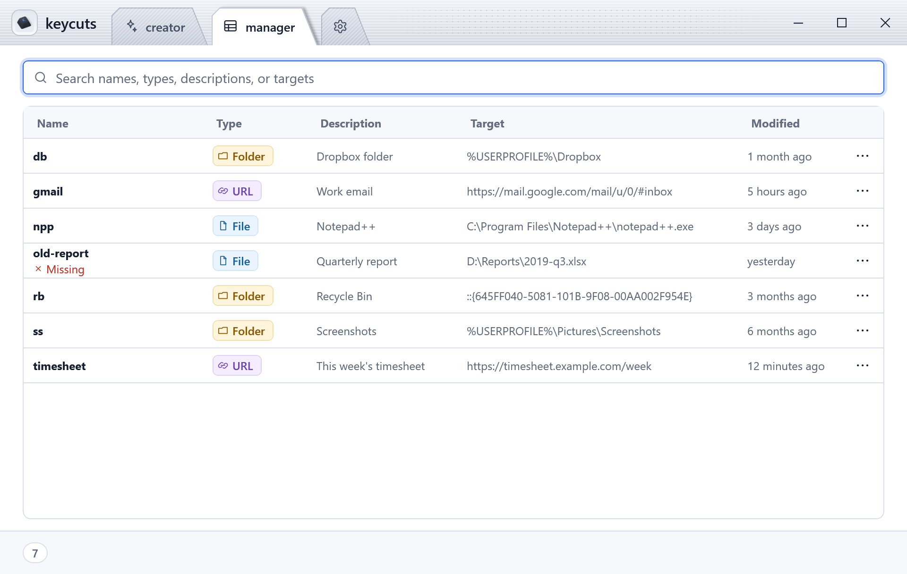
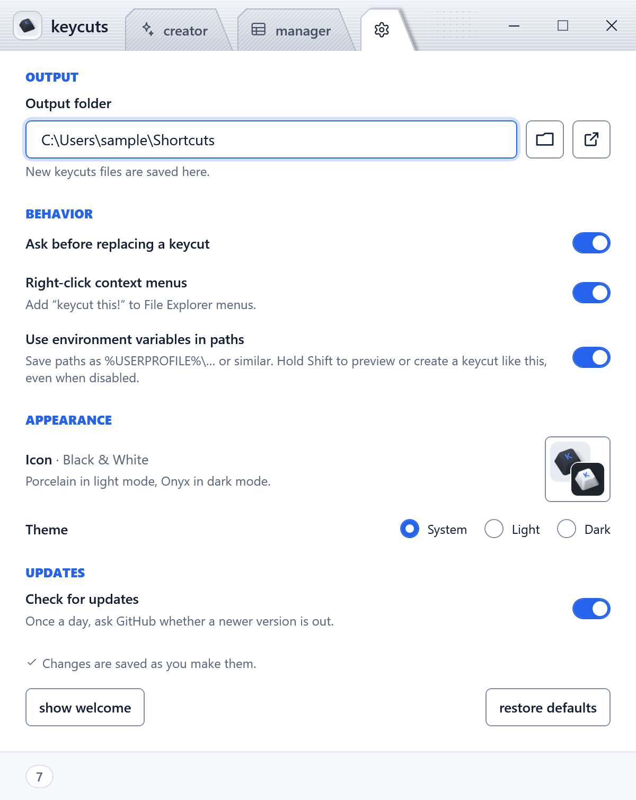

# keycuts

Open any file, folder or URL on your PC by typing a nickname in Win+R.

<picture>
  <source media="(prefers-color-scheme: dark)" srcset="docs/images/walkthrough-dark.gif">
  
</picture>

A keycut is a tiny `.bat` file in a folder on your `PATH`, so Win+R finds it by name:

* `npp` opens Notepad++, `gmail` opens your email, `db` opens your Dropbox folder, `rb` opens the Recycle Bin.

Make one by dropping a target on the app and naming it, from the right-click menu (**keycut this!**), or from the CLI.

## Install

Download the MSI from the [latest release](https://github.com/andrewralon/keycuts/releases/latest): `keycuts-setup-x64.msi` for most PCs, `keycuts-setup-arm64.msi` for Windows on ARM. It installs for your account only (no admin rights) and includes the .NET runtime. It asks where to keep your keycuts (default `%USERPROFILE%\Shortcuts`) and adds that folder to your `PATH`. Silent install: `msiexec /i keycuts-setup-x64.msi /qn OUTPUTFOLDER="C:\Shortcuts"`. Uninstalling keeps your keycuts and settings.

## Using it

The screenshots follow your GitHub theme; the app follows Windows, or the choice in Settings.

**Creator.** Drop a file, folder, `.lnk` or link on the window (or paste, or use the folder button to browse), type a name, press **Enter** or the rocket. **Saving** and **Created** show at the right of the Name label (Created for three seconds), and the fields stay filled in afterwards, so a keycut made a little differently is a small edit away. The target wraps if it is long, and shows the `%VAR%` form of a path when it will be saved that way. Click **Add a description (optional)** if you like; the box stays shown or hidden the way you left it. **manager** opens the table of your keycuts. On the first run, and whenever your keycuts folder is empty, a welcome panel says what keycuts does and offers three keycuts to start with: `g` for google.com, `dl` for your Downloads folder, and `kc` for keycuts itself. Click one to fill in the fields below, press Enter or the rocket to create it, and click another to make that one too. **Got it** clears the fields.

<picture>
  <source media="(prefers-color-scheme: dark)" srcset="docs/images/creator-dark.png">
  
</picture>

**Manager.** The **manager** tab shows a table you can search and sort by any column, including **Modified**; while a search hides some keycuts, **X of Y shown** appears at the right of the search box. Up/Down, Home/End and Page Up/Page Down move the selection, Enter opens the row, and from the search box Ctrl+E edits it, Ctrl+Shift+E edits it in Notepad, Ctrl+Shift+O shows its file, Ctrl+C copies its target, F2 renames it, Delete deletes it and Ctrl+F searches. Delete and Home/End are the search box's while it holds text, and Ctrl+C while text is selected in it. The `...` menu has **Open**, **Edit**, **Edit in Notepad**, **Open file location**, **Copy target** and **Delete**, each with its key. Missing targets are flagged in red, and a hand-written launcher that still starts but names a start-in folder that doesn't exist gets a yellow warning.

<picture>
  <source media="(prefers-color-scheme: dark)" srcset="docs/images/manager-dark.png">
  
</picture>

* **Rename and Edit description** change the name or the description where it is: click it on the selected row (a click on another row only selects it), or press F2 or Shift+F2. Enter saves, Escape cancels, and clicking away saves. A description change rewrites just that line of the `.bat`, so it works on a keycut you've changed by hand too.
* **Column widths** can be dragged: the divider after **Name** and the one between **Description** and **Target** (the line shows when you point at it). The other columns give way and the table never scrolls sideways; the whole text of a cell is in its tooltip. Widths go back to normal when the app restarts.
* **Edit** changes the target, name and description. It's offered only for a keycut the app would have written itself; one you've changed by hand says to use **Edit in Notepad**, so your edits are never lost.
* **Delete** moves the file to the Recycle Bin (drives without one, such as network shares, delete for good). **Undo** (or Ctrl+Z) shows in the footer for a few seconds and restores the file's contents and modified date.

**Settings.** The gear tab in the bar at the top of the window opens it, and every change is saved as you make it: there is no Save button. The output folder (saved when you press Enter, leave the box, or pick one with the folder button), **Ask before replacing a keycut**, the right-click menu (on Windows 11 under **Show more options**), the theme and update checks. **Use environment variables in paths** (off by default) saves paths like `%USERPROFILE%\Desktop`, so a keycuts folder still works on another PC; hold Shift in the Creator to flip it for one keycut. **restore defaults** puts every setting back as a new install has it, except the output folder, after asking; **show welcome** brings back the first-run panel. Escape goes back to the creator.

**Icon.** Click the icon in Settings to pick another: **Black & White** (the default) and **Accent** switch with the light and dark theme, and Porcelain, Onyx, Cobalt, Twilight and the original Classic stay the same. A pick applies at once to the window, the taskbar and Alt+Tab, and to the app's Start menu, desktop and pinned taskbar shortcuts (Windows can take a moment to redraw a pinned one). The icons, in every size and with transparent versions, are in [assets/icons](assets/icons).

<picture>
  <source media="(prefers-color-scheme: dark)" srcset="docs/images/settings-dark.png">
  
</picture>

**Updates.** When a newer release exists, the footer of both screens says so and **Download** opens the release page. The app checks at most once a day, with one unauthenticated request to GitHub and no telemetry; the CLI never checks. Turn it off in Settings.

## Command line

* `keycuts -t <target> -s <name> [--description "text"]` creates a keycut. It asks the same name questions as the app; `-f` skips them, and with redirected input it exits with code 14 instead of waiting.
* `keypaste db` (or `keycuts paste db`) copies the `db` keycut's target to the clipboard.
* `keycuts` alone opens the app; `keycuts -h` lists the options.

A keycut can't be named `keycuts` or `keypaste`; existing ones are renamed to `*_previous` at startup.

## Development

.NET SDK 10. From the repository root:

* Format: `dotnet format keycuts.sln --verify-no-changes --severity error`
* Build: `dotnet build keycuts.sln`
* Test: `dotnet test keycuts.sln`
* Installer: `pwsh -File tools/Build-Installer.ps1` (`-Runtime win-arm64` for ARM)
* Sample keycuts: `tools/New-SampleKeycuts.ps1` (use with `KEYCUTS_OUTPUT_FOLDER` in a Debug build)
* Screenshots and walkthrough: `pwsh -File tools/New-Screenshots.ps1`

**Releasing.** Raise `<Version>` in `Directory.Build.props`, run the screenshots script, then merge `develop` into `main`.
