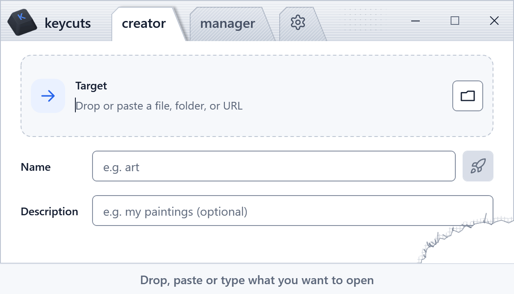
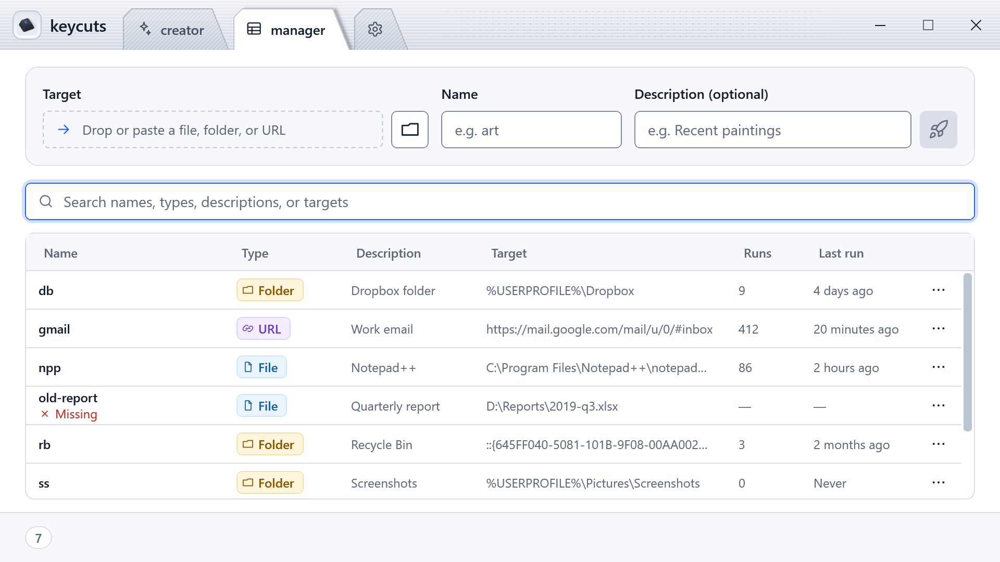
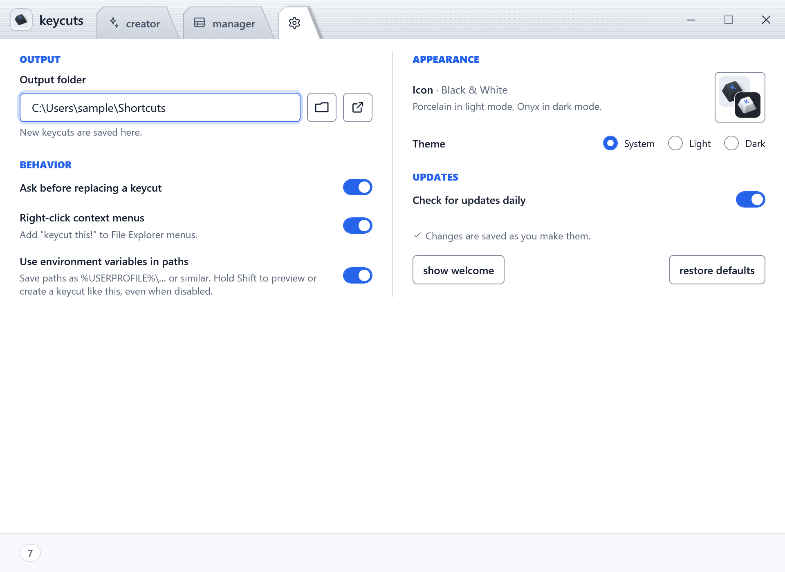
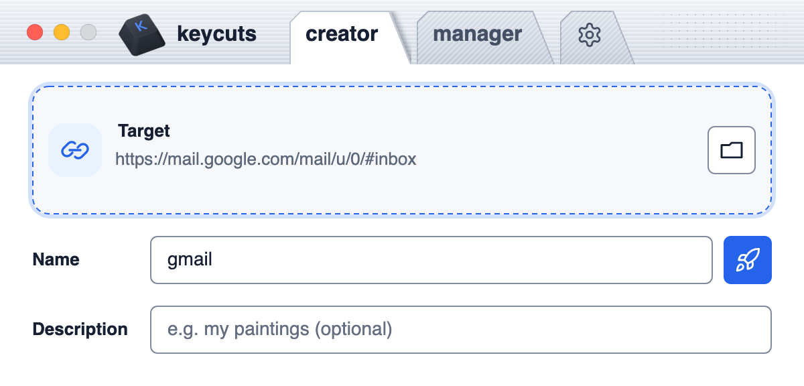
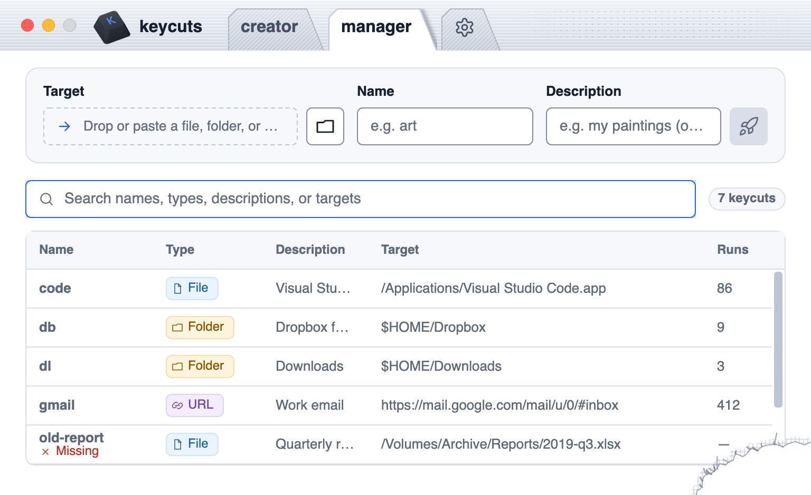
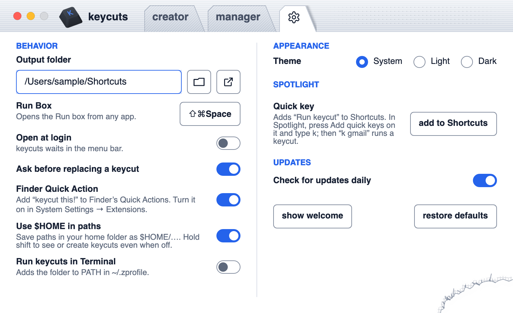

# keycuts

Open any file, folder or URL by typing a nickname in Win+R.

<picture>
  <source media="(prefers-color-scheme: dark)" srcset="docs/images/walkthrough-dark.gif">
  
</picture>

Each keycut is a small `.bat` file in a folder on your `PATH`: `npp` opens Notepad++, `gmail` opens your email, `db` opens Dropbox.

## Install

Grab the MSI from the [latest release](https://github.com/andrewralon/keycuts/releases/latest) (`x64`, or `arm64` for Windows on ARM). No admin rights needed; .NET is included. Uninstalling keeps your keycuts.

Silent: `msiexec /i keycuts-setup-x64.msi /qn OUTPUTFOLDER="C:\Shortcuts"`

**On macOS** (13 or later): `brew install --cask andrewralon/tap/keycuts`, or the `.pkg` from the [latest release](https://github.com/andrewralon/keycuts/releases/latest) (`arm64` for Apple Silicon, `x64` for Intel). It puts `keycuts.app` in Applications and makes `~/Shortcuts` the first time it starts. Finder's right-click item **keycut this!** starts out switched off: turn it on in System Settings → General → Login Items & Extensions → Extensions → Finder.

## Uninstall

**Windows:** remove keycuts in Settings → Apps. Your keycuts stay.

**On macOS**, take out what keycuts added, then the app:

1. Turn off **Open at login** and **Run keycuts in Terminal** in Settings (⌘,), or in Terminal run `keycuts path remove`. That takes the marked block out of your shell profile and leaves the rest of the file as it was.
2. Run `keycuts uninstall-shell-integration` to take **keycut this!** out of Finder.
3. Quit keycuts from the menu bar, then `brew uninstall --cask keycuts`. Without Homebrew, drag `keycuts.app` from Applications to the Trash and run `sudo pkgutil --forget com.teamralon.keycuts`.
4. To also remove the settings and run counts, delete `~/Library/Application Support/keycuts` (`brew uninstall --zap --cask keycuts` does this too).

Your keycuts in `~/Shortcuts` stay. The `keycuts` and `keypaste` commands in that folder only work with the app installed, so delete those two files if you like.

## Use

**Create:** drop, paste or browse to a target, type a name, press Enter. Or right-click anything → **keycut this!**

<picture>
  <source media="(prefers-color-scheme: dark)" srcset="docs/images/creator-dark.png">
  
</picture>

**Manage:** add keycuts from the row at the top, search, sort, and right-click a keycut to open, rename, edit or delete it (with undo). Missing targets are flagged. Each keycut counts its runs, so sorting by **Runs** or **Last run** shows which ones you never use.

<picture>
  <source media="(prefers-color-scheme: dark)" srcset="docs/images/manager-dark.png">
  
</picture>

**Settings:** output folder, theme, icon (with or without its background), right-click menu, update checks, and environment-variable paths (`%USERPROFILE%\...`) for a portable keycuts folder.

<picture>
  <source media="(prefers-color-scheme: dark)" srcset="docs/images/settings-dark.png">
  
</picture>

**On macOS** the same window has the Mac's own buttons, ⌘ keys, `$HOME` paths, and a switch that puts the keycuts folder on your Terminal PATH:

<details>
<summary>The creator, the manager and Settings on macOS</summary>

<picture>
  <source media="(prefers-color-scheme: dark)" srcset="docs/images/creator-dark-mac.png">
  
</picture>

<picture>
  <source media="(prefers-color-scheme: dark)" srcset="docs/images/manager-dark-mac.png">
  
</picture>

<picture>
  <source media="(prefers-color-scheme: dark)" srcset="docs/images/settings-dark-mac.png">
  
</picture>

</details>

The app checks GitHub for updates at most once a day. No telemetry: run counts are files in `%LOCALAPPDATA%\keycuts\usage` that never leave your PC.

**Keycuts from older versions:** the first time the app opens a keycuts folder, it brings keycuts written by older versions to the current format. It renames their `<destination>` line to `<target>`, and folder keycuts get `START "" /B` in front of their Explorer line, so their console window closes sooner. Nothing else in the files changes, and their date modified stays the same. The originals are copied to a hidden `.keycuts-backup\<date-time>` folder inside the keycuts folder first, and a message says where.

## Command line

```
keycuts -t <target> -s <name> [--description "text"] [-f]
keypaste <name>      # copy a keycut's target to the clipboard
keycuts list [<search>] [--usage] [--sort name|runs|last-run] [--json]   # list keycuts, with run counts
keycuts rename <old> <new> [-f]   # rename a keycut, as the manager does
keycuts rm <name>                 # delete a keycut, to the Recycle Bin
keycuts open <name>               # open a keycut, as Win+R does
keycuts              # open the app
```

## Development

.NET SDK 10:

```
dotnet build keycuts.sln
dotnet test keycuts.sln
pwsh -File tools/Build-Installer.ps1
```

To release: bump `<Version>` in `Directory.Build.props`, run `tools/New-Screenshots.ps1` (the screenshots and walkthrough GIFs in `docs/images`) and commit what changed, merge `develop` into `main`.
