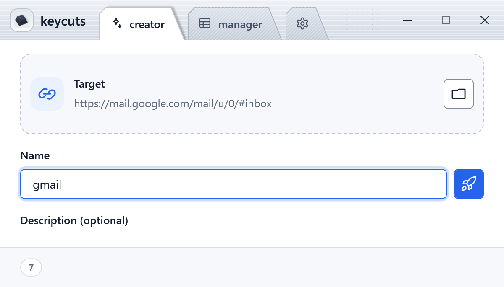

# keycuts

Open any file, folder or URL by typing a nickname in Win+R.

<picture>
  <source media="(prefers-color-scheme: dark)" srcset="docs/images/walkthrough-dark.gif">
  
</picture>

Each keycut is a small `.bat` file in a folder on your `PATH`: `npp` opens Notepad++, `gmail` opens your email, `db` opens Dropbox.

## Install

Grab the MSI from the [latest release](https://github.com/andrewralon/keycuts/releases/latest) (`x64`, or `arm64` for Windows on ARM). No admin rights needed; .NET is included. Uninstalling keeps your keycuts.

Silent: `msiexec /i keycuts-setup-x64.msi /qn OUTPUTFOLDER="C:\Shortcuts"`

## Use

**Create:** drop, paste or browse to a target, type a name, press Enter. Or right-click anything → **keycut this!**

<picture>
  <source media="(prefers-color-scheme: dark)" srcset="docs/images/creator-dark.png">
  
</picture>

**Manage:** add keycuts from the row at the top, search, sort, and right-click a keycut to open, rename, edit or delete it (with undo). Missing targets are flagged. Each keycut counts its runs, so sorting by **Runs** or **Last run** shows which ones you never use.

<picture>
  <source media="(prefers-color-scheme: dark)" srcset="docs/images/manager-dark.png">
  
</picture>

**Settings:** output folder, theme, icon (with or without its background), right-click menu, update checks, and environment-variable paths (`%USERPROFILE%\...`) for a portable keycuts folder.

<picture>
  <source media="(prefers-color-scheme: dark)" srcset="docs/images/settings-dark.png">
  
</picture>

The app checks GitHub for updates at most once a day. No telemetry: run counts are files in `%LOCALAPPDATA%\keycuts\usage` that never leave your PC.

## Command line

```
keycuts -t <target> -s <name> [--description "text"] [-f]
keypaste <name>      # copy a keycut's target to the clipboard
keycuts              # open the app
```

## Development

.NET SDK 10:

```
dotnet build keycuts.sln
dotnet test keycuts.sln
pwsh -File tools/Build-Installer.ps1
```

To release: bump `<Version>` in `Directory.Build.props`, run `tools/New-Screenshots.ps1` (the screenshots and walkthrough GIFs in `docs/images`) and commit what changed, merge `develop` into `main`.
