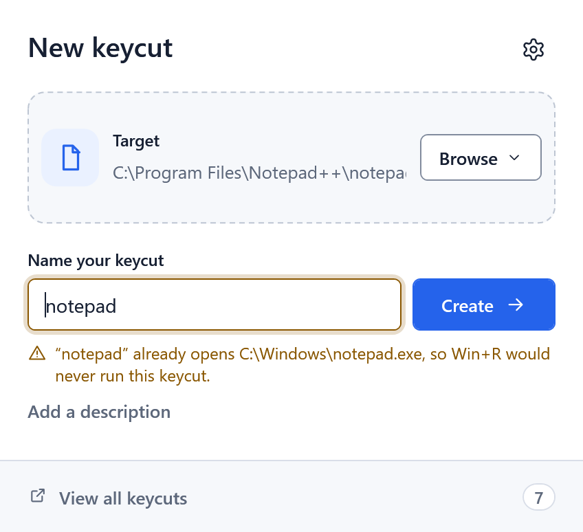
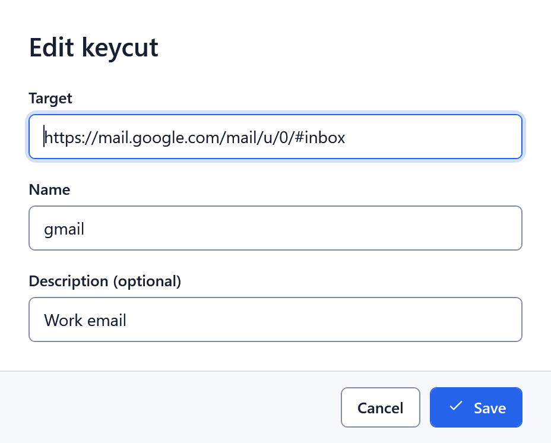

# keycuts

Open any file, folder or URL on your PC by typing a nickname in Win+R.

<picture>
  <source media="(prefers-color-scheme: dark)" srcset="docs/images/walkthrough-dark.gif">
  
</picture>

A keycut is a tiny `.bat` file in a folder on your `PATH`, so Win+R finds it by name:

* `npp` opens Notepad++, `gmail` opens your email, `db` opens your Dropbox folder, `rb` opens the Recycle Bin.

Make one by dropping a target on the app and naming it, from the right-click menu (**keycut this!**), or from the CLI.

## Install

Download the MSI from the [latest release](https://github.com/andrewralon/keycuts/releases/latest): `keycuts-setup-x64.msi` for most PCs, `keycuts-setup-arm64.msi` for Windows on ARM. It installs for your account only (no admin rights) and includes the .NET runtime. It asks where to keep your keycuts (default `%USERPROFILE%\Shortcuts`) and adds that folder to your `PATH`. Silent install: `msiexec /i keycuts-setup-x64.msi /qn OUTPUTFOLDER="C:\Shortcuts"`. Uninstalling keeps your keycuts and settings.

## Using it

The screenshots follow your GitHub theme; the app follows Windows, or the choice in Settings.

**Creator.** Drop a file, folder, `.lnk` or link on the window (or paste, or **Browse**), type a name, press **Enter**. **Add a description** if you like. On the first run, and whenever your keycuts folder is empty, a welcome panel offers a keycut named `kc` that opens the app.

**Name warnings.** keycuts checks a name the way Win+R looks it up (Windows and System32, your `PATH`, App Paths). It warns when something else would win over the keycut, or when the keycut would hide a program, and asks before replacing a keycut.

  <picture>
    <source media="(prefers-color-scheme: dark)" srcset="docs/images/creator-dark.png">
    
  </picture>
  <picture>
    <source media="(prefers-color-scheme: dark)" srcset="docs/images/name-warning-dark.png">
    
  </picture>

**Manager.** **View all keycuts** shows a table you can search and sort by any column, including **Modified**. Up/Down and Enter open a row, F2 renames it, and the `...` menu has **Open**, **Edit**, **Edit in Notepad**, **Open file location**, **Copy target** and **Delete**. Missing targets are flagged.

<picture>
  <source media="(prefers-color-scheme: dark)" srcset="docs/images/manager-dark.png">
  
</picture>

* **Edit** changes the target, name and description. It's offered only for a keycut the app would have written itself; one you've changed by hand says to use **Edit in Notepad**, so your edits are never lost.
* **Delete** moves the file to the Recycle Bin. **Undo** (or Ctrl+Z) shows in the status bar for a few seconds and puts it back exactly as it was.

**Settings.** The output folder, **Ask before replacing a keycut**, the right-click menu (on Windows 11 under **Show more options**), the theme and update checks. **Use environment variables in paths** (off by default) saves paths like `%USERPROFILE%\Desktop`, so a keycuts folder still works on another PC; hold Shift in the Creator to flip it for one keycut.

  <picture>
    <source media="(prefers-color-scheme: dark)" srcset="docs/images/edit-dark.png">
    
  </picture>
  <picture>
    <source media="(prefers-color-scheme: dark)" srcset="docs/images/settings-dark.png">
    
  </picture>

**Updates.** When a newer release exists, the Creator's footer says so and **Download** opens the release page. The app checks at most once a day, with one unauthenticated request to GitHub and no telemetry; the CLI never checks. Turn it off in Settings.

## Command line

* `keycuts -t <target> -s <name> [--description "text"]` creates a keycut. It asks the same name questions as the app; `-f` skips them, and with redirected input it exits with code 14 instead of waiting.
* `keypaste db` (or `keycuts paste db`) copies the `db` keycut's target to the clipboard.
* `keycuts` alone opens the app; `keycuts -h` lists the options.

A keycut can't be named `keycuts` or `keypaste`; existing ones are renamed to `*_previous` at startup.

## Development

Needs the .NET SDK 10. From the repository root:

* Format: `dotnet format keycuts.sln --verify-no-changes --severity error`
* Build: `dotnet build keycuts.sln` (0 warnings, and it should stay that way)
* Test: `dotnet test keycuts.sln` (tests use temp folders, never the real output folder or the registry)
* Installer: `pwsh -File tools/Build-Installer.ps1` (add `-Runtime win-arm64` for ARM)
* Sample data: Debug builds honor `KEYCUTS_OUTPUT_FOLDER` (no registry or `PATH` changes); `tools/New-SampleKeycuts.ps1` makes a fixture folder.
* Screenshots: `pwsh -File tools/New-Screenshots.ps1` renders the real views with sample keycuts into `docs/images`, light and dark. The walkthrough GIF is rendered the same way, not recorded, so its Win+R step is a caption. To add a view, add it to `ScreenshotTests`.

**Releasing.** Raise `<Version>` in `Directory.Build.props`, regenerate the screenshots and commit anything that visibly changed, then merge `develop` into `main`. The release workflow tags `v<Version>` and publishes both MSIs, portable zips and SHA-256 checksums. A merge that doesn't change the version doesn't release.
